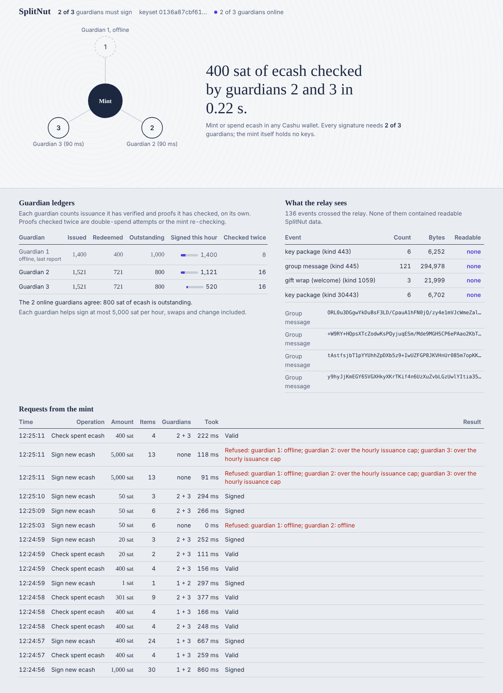

# SplitNut

**A Cashu mint whose signing keys are split across guardians, so no single party holds them.**

A Cashu mint's private keys normally sit with one operator, who can sign unbacked ecash at
will, and no wallet can tell. In SplitNut every mint key exists only as shares held by *n*
guardians, who generate it together (distributed key generation), so no one ever sees the
whole key. Any *t* of them must cooperate to produce a signature, so neither the mint server
nor any one guardian has a key to steal or misuse.

The guardians also check *what* they sign. A small CDK change makes the mint tell the signer
what each signature is for: a swap's inputs, a melt's quote and inputs, the quotes behind an
issuance. Each guardian checks it before releasing its share. It refuses swaps whose outputs
exceed their inputs, inputs it cannot verify as genuine, inputs already spent (including by a
melt), and issuance beyond what a quote was paid. So swaps and melts cannot create ecash, even
if the mint host is compromised. The one thing guardians must still take on trust is that a
mint quote was paid: that is capped per hour, allowed once per quote and recorded in every
guardian's ledger. See [operation context](docs/operation-context.md) and the
[threat model](#threat-model).

* **Wallets see a normal mint.** Standard keysets, token format and NUT-12 DLEQ proofs. Tested
  with cdk-cli, which verifies every threshold signature's DLEQ; cashu-ts (used by cashu.me)
  checks DLEQs the same way.
* **Almost no mint fork.** `cdk-mintd` already sends all signing to a remote signer over gRPC,
  and SplitNut *is* that signer: a coordinator that gathers threshold shares from guardians.
  The one change is a backwards-compatible CDK commit that passes operation context to the
  signer ([rademenezbtc/cdk@702e5bc](https://github.com/rademenezbtc/cdk/commit/702e5bc76b0cfa88b6b3f4ecb5920bfbf7edd4ab)),
  to be proposed upstream.
* **Guardians coordinate over Marmot** (MLS over Nostr): an end-to-end encrypted group where
  relays see only ciphertext. Any Nostr relays work; `splitnut-relay` is a local one with a
  wire tap that counts events and flags any plaintext.

Built for [Nut November 2026](https://nutnovember.org).

## Demo

**Video (2 minutes):** [video link]: a wallet mints and spends while guardians sign; one
guardian goes offline and minting continues; a second goes offline and the mint refuses; the
guardians' ledgers match the wallets and the relay read nothing.



**Try it** (needs `cdk-mintd` and `cdk-cli` from CDK v0.18.3 plus the operation-context commit,
see [docs/RUNNING.md](docs/RUNNING.md)):

```sh
CDK_BIN=/path/to/cdk/target/release ./scripts/demo.sh
```

One command starts a relay, three guardians, the coordinator and a keyless cdk-mintd. Mint
from any wallet at `http://127.0.0.1:8085/`, watch http://127.0.0.1:8090/, and switch
guardians off and on with `./scripts/guardian.sh stop 3` / `start 3`. Public relays, phone
wallets and all settings: [docs/RUNNING.md](docs/RUNNING.md).

## Status

- [x] **Milestone 1, spike:** cdk-mintd with no local keys, signing through a remote signer;
      mint, swap and melt with cdk-cli (`scripts/spike.sh`, findings in [docs/spike.md](docs/spike.md))
- [x] **Milestone 2, threshold signing in process:** stock cdk-mintd signs through
      `splitnut-coord` with three guardians, 2-of-3. cdk-cli mints, swaps and melts, and checks
      the DLEQ of every combined signature. One guardian down still works; two down is
      refused with "quorum unavailable" (`scripts/m2.sh`)
- [x] **Milestone 3, guardians over Marmot:** three guardian processes with their own
      Nostr keys and the coordinator form one MLS group over Nostr. Killing a guardian keeps
      the mint working, killing a second makes it refuse, and restarting one resumes signing
      from its encrypted state. The relay sees only ciphertext (`scripts/m3.sh`)
- [x] **Milestone 4, rules and dashboard:** each guardian keeps its own ledger (issuance it
      has verified by DLEQ, redemptions it has checked) and an hourly signing cap; heartbeats
      make quorum loss an immediate, explained refusal; a live dashboard shows each request,
      the guardians, their ledgers and what the relay sees (`scripts/m4.sh`)
- [ ] **Milestone 5, demo and submission (in progress):** one-command demo
      (`scripts/demo.sh`), demo video (re-recordable with `scripts/video/record.py`), deck,
      submission kit ([docs/SUBMISSION.md](docs/SUBMISSION.md)); still to do: a run on public
      relays and a phone wallet
- [x] **Operation context:** a CDK commit passes each operation to the signer, and guardians
      check it: swaps and melts must balance, inputs must carry evidence that they are genuine,
      no input may be spent twice, issuance is bounded by its quotes, and the cap applies to new
      money only. `examples/evil_mintd.rs` attacks the guardians as a compromised mint host;
      `m4.sh` runs it and every attack is refused ([docs/operation-context.md](docs/operation-context.md))
- [x] **Distributed key generation:** the guardians generate the keyset among themselves over
      the Marmot group (joint Feldman VSS; shares NIP-44-encrypted guardian to guardian, so the
      coordinator relaying them cannot read them). Nobody ever holds a whole mint key; the
      trusted dealer remains only as an option (`KEYGEN=dealer`). `m4.sh` and `demo.sh` use
      DKG ([docs/dkg.md](docs/dkg.md))

## Next

The goal is for every guardian to sign only what it can justify itself, without trusting the
mint host or the coordinator. Swaps and melts now meet that goal; what is left:

1. **A public ledger.** Guardians publish signed totals to Nostr, so anyone can compare the
   ecash in circulation with the mint's reserves.
2. **Catch-up.** A guardian that was offline replays the operations it missed and refuses to
   sign while behind, so double-spend protection doesn't depend on every announcement arriving.
3. **Upstream** the operation-context change to CDK.

## Architecture

```
wallet ──HTTP──▶ cdk-mintd (no keys; passes operation context)
                    │ gRPC (CDK signatory API, mTLS)
                    ▼
              splitnut-coord ──Marmot group──▶ splitnut-guardian × n
              (combines + checks shares,        (one share of every key,
               holds no key material)            rules, ledger)
```

| Crate | Role |
|-------|------|
| `splitnut-core` | Share maths, Lagrange combination, DLEQ round logic, distributed key generation |
| `splitnut-proto` | Messages on the Marmot channel |
| `splitnut-dealer` | Optional trusted-dealer key generation (tests, fallback) |
| `splitnut-guardian` | Guardian daemon: `dkg` takes part in key generation, `run` signs by the rules |
| `splitnut-coord` | Remote signer for cdk-mintd plus Marmot fan-out and dashboard; `--dkg` runs key generation |
| `splitnut-marmot` | Marmot node: MDK + Nostr client in one actor, group setup, encrypted MLS state |
| `splitnut-relay` | Local in-memory relay with a wire tap |

## Tests

```sh
cargo test --workspace
git clone https://github.com/rademenezbtc/cdk && cd cdk
git checkout 702e5bc76b0cfa88b6b3f4ecb5920bfbf7edd4ab   # v0.18.3 + operation context
cargo build --release -p cdk-mintd -p cdk-cli   # needs protoc
cd ../splitnut && CDK_BIN=../cdk/target/release ./scripts/m4.sh
```

`m4.sh` deals a 2-of-3 keyset, gives the coordinator and each guardian a Nostr key, starts a
local relay, three guardian processes, the coordinator and a keyless cdk-mintd, then runs
cdk-cli through mint, send, receive, double spend and melt, kills guardians one by one,
restarts one, tries to mint over the hourly cap, attacks the guardians as a compromised mint
host (each attack must be refused), and checks that every online guardian's outstanding total
equals the wallets' combined balance. To use public relays instead:
`RELAYS="wss://relay.damus.io wss://nos.lol" CDK_BIN=... ./scripts/m4.sh`.

Typical run on a laptop-class machine with a local relay: the group forms in about 4 s; a
two-round threshold signature takes 0.3 to 0.9 s for 1 to 30 outputs, and a proof check
about 0.2 s.

## How the signing works

Each mint key `k` (one per amount) is shared t-of-n among the guardians by distributed key
generation, so `k` itself is never computed anywhere. For a blinded message `B'`
the coordinator runs two rounds with t guardians: each returns `k_i·B'` plus nonce
commitments `r_i·G` and `r_i·B'`, then `s_i = r_i + e·k_i` for the NUT-12 challenge `e`.
Lagrange-combined, this is exactly the signature and DLEQ proof a single-key mint would
produce, so wallets cannot tell the difference. Every share is checked against the
guardian's public share before combining, and a cheating guardian is named and excluded.
Proof checks (`verify_proofs`) work the same way in one round. Details are in
`crates/splitnut-core`.

## Threat model

SplitNut guarantees two things: **no single party, the mint operator included, holds a mint
key, nor ever did (the guardians generate the keys together), and a valid signature needs t
guardians**; and **swaps and melts cannot create ecash**, because every guardian checks them itself.
New ecash can only come from a mint quote, which guardians cap and count but cannot verify.

**Protected**

* *Key theft.* cdk-mintd holds no keys, and one guardian's share is useless alone. Stealing the
  mint server or a single guardian does not yield a mint key. Whoever controls the mint host can
  still *request* signatures, but the guardians check every request (below).
* *A rogue or offline guardian, below threshold.* Every share is checked against that guardian's
  public share before combining; a bad share names the guardian, who is excluded while the
  request restarts with fresh nonces. Offline guardians are skipped.
* *Relay operators.* Guardians talk inside an MLS group (Marmot); relays see gift wraps and
  ciphertext only. The bundled relay's wire tap checks this on every event.
* *The coordinator.* It holds no key material and cannot forge signatures or combine a bad
  share undetected. It cannot vouch for an input either: guardians check the evidence
  themselves. It can refuse service or delay requests.
* *A dishonest or compromised mint host, for swaps and melts.* Guardians refuse unbalanced
  swaps, inputs without valid evidence, double spends (across swaps and melts) and excess melt
  change. `examples/evil_mintd.rs` tries all of these.

**Rules guardians enforce** (details in [docs/operation-context.md](docs/operation-context.md))

* *Context required.* A request without operation context (a stock cdk-mintd) is refused,
  unless the guardian runs with `--allow-contextless` (v1 rules).
* *Swaps and melts.* Every input comes with t guardians' partial evaluations and DLEQs, which
  each guardian checks combine to the proof's `C`. Outputs ≤ inputs − fees (melt change also
  minus the amount paid). No input already spent by another operation. The same inputs are
  never signed for two different output sets.
* *Issuance.* Outputs ≤ what the quotes were paid minus what this guardian already issued
  against them; one bolt11 payment hash per quote.
* *Hourly cap on new money.* Each guardian refuses to help issue more than its cap per rolling
  hour against mint quotes, checked and recorded in round 1 (whose answer already contains its
  share). A coordinator that rotates signer sets can reach at most `cap × n / t` per hour.
* *Independent ledgers.* After each signature the coordinator announces the finished
  signatures to all guardians; each guardian checks every DLEQ against the public mint key
  before counting it, so its *issued* total is issuance it can prove happened. Proof checks go
  to all guardians, and each proof counts as *redeemed* once. `outstanding = issued − redeemed`
  is the ecash in circulation as that guardian sees it, to compare with the mint's Lightning
  balance. In the end-to-end test every online guardian's outstanding equals the wallets'
  combined balance.

**Not protected in v1**

* *Mint quotes.* A guardian cannot prove that a mint quote's invoice was paid: the mint created
  the invoice and knows its preimage. (A preimage does prove a *melt* was paid, because there
  the invoice comes from someone else.) So a dishonest host can still issue unbacked ecash
  against quotes that were never paid, up to `cap × n / t` per hour; the ledgers record it.
  Verifying deposits needs guardians with their own view of the payment, for example reserves
  on chain at an address the guardians control; that is roadmap.
* *Missed announcements.* Guardians learn of spends they did not sign from the coordinator's
  announcements. A guardian that was offline, or left out, can miss one, so with t − 1
  colluding guardians the coordinator could get a double spend past a guardian that never heard
  of the first spend. Catch-up is next.
* *Spending conditions.* P2PK and HTLC locks are checked by the mint only, so a dishonest host
  can let the wrong person spend a locked token. That moves ecash; it does not create any.
* *Custody.* The operator still holds the Lightning funds. SplitNut targets unbacked issuance
  (inflation), not theft of the reserves.
* *Key generation.* Distributed key generation (joint Feldman VSS) needs all n guardians online
  for the ceremony, aborts rather than repairs if any share is invalid (naming the dealer), and
  lets a guardian that colludes with the coordinator bias the public key's distribution, but
  not learn the key. Guardians take each other's Nostr keys from a roster file they hold
  themselves, so the coordinator cannot substitute its own. The optional trusted dealer
  (`KEYGEN=dealer`) sees every full key once; use it only for tests.
* *Collusion.* t guardians together can do anything a single operator could. Choose t and n
  accordingly.
* *Liveness.* With fewer than t guardians online the mint stops issuing and redeeming. That is
  the intended failure mode, and it is an immediate, explained refusal rather than a hang.
* *Ledger caveats.* A guardian that was offline misses events, so its totals lag (the dashboard
  says when online guardians disagree). Proofs count as redeemed only once a guardian has
  checked evidence that they are genuine; "checked twice" counts refused double-spend attempts.
  Proofs from a failed melt can afterwards only be retried for the same melt quote.
* *Relay rate limits.* Relays typically accept about one event per second per publisher.
  SplitNut batches identical requests into one message and retries rejected publishes, and the
  test runs under a tighter-than-default limit, but very busy mints would need relays that
  allow more.

## Licence

MIT. See [LICENSE](LICENSE).
